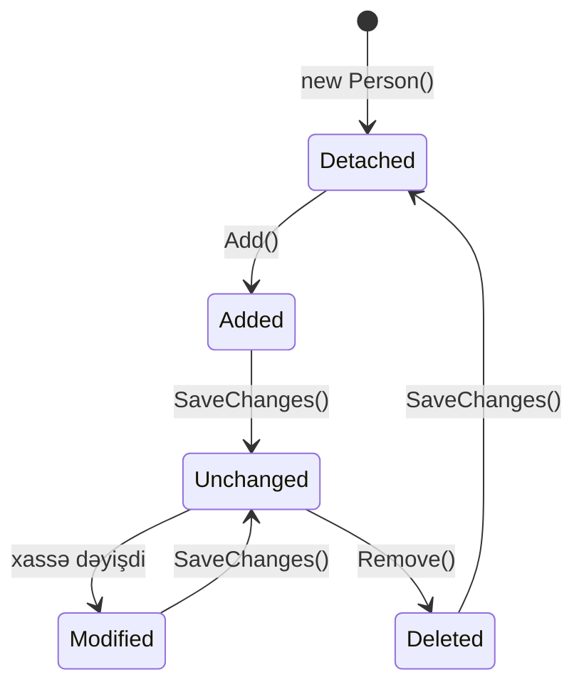

<div align="center">

# Entity Framework Core — Öyrənmə Yolu

**EF Core-un əsaslarını kiçik, ayrı-ayrı konsol nümunələri ilə öyrənmək üçün qeydlər və kod**


</div>

---

## 📌 Haqqında

Bu repozitoriya **Entity Framework Core** öyrənərkən yazdığım nümunələrdir.
Hər mövzu ayrıca konsol layihəsidir və kodun içində **Azərbaycan dilində ətraflı şərhlər** var — hər metodun nə etdiyi və nə vaxt istifadə olunduğu izah edilib.

Bütün nümunələr eyni sadə modeldən istifadə edir: `Person` cədvəli və `AppDbContext`.

---

## 📚 Mövzular

| # | Layihə | Mövzu | Nələr göstərilir |
|---|---|---|---|
| 1 | [`EFCrudOperations`](src/EFCrudOperations/Program.cs) | **CRUD əməliyyatları** | `Add`, `Update`, `Remove`, `SaveChangesAsync`, `EntityState` (Detached → Added → Unchanged) |
| 2 | [`EFQuerying`](src/EFQuerying/Program.cs) | **Əsas sorğular** | `ToListAsync`, `Where`, `OrderBy`, `ThenBy`, `Single`, `First`, `Last`, `Find` (+ `OrDefault` variantları) |
| 3 | [`EFOtherQuerying`](src/EFOtherQuerying/Program.cs) | **Aqreqat və digər sorğular** | `Count`, `LongCount`, `Any`, `All`, `Max`, `Min`, `Sum`, `Average`, `Distinct`, `Contains`, `StartsWith`, `EndsWith`, `Select`, `GroupBy`, `ToDictionary`, `ToArray` |
| 4 | [`EFChangeTracker`](src/EFChangeTracker/Program.cs) | **Change Tracker** | Obyekt vəziyyətlərinin izlənməsi, `ChangeTracker.Entries()`, `DetectChanges()`, `Added` / `Modified` / `Deleted` / `Unchanged` |

---

## 🧠 Əsas anlayışlar

### Entity vəziyyətləri (`EntityState`)



| Vəziyyət | Mənası |
|---|---|
| `Detached` | EF Core obyekti izləmir |
| `Added` | Yeni obyekt — `SaveChanges` zamanı `INSERT` olunacaq |
| `Unchanged` | Bazadakı ilə eynidir |
| `Modified` | Dəyişib — `UPDATE` olunacaq |
| `Deleted` | Silinəcək — `DELETE` olunacaq |

### `First` vs `Single` vs `Find`

| Metod | Nə vaxt istifadə olunur |
|---|---|
| `FirstAsync` | Şərtə uyğun **ilk** qeyd; tapılmasa xəta |
| `SingleAsync` | Şərtə uyğun **tək** qeyd; tapılmasa və ya birdən çox olsa xəta |
| `FindAsync` | **Primary key** ilə axtarış; əvvəlcə yaddaşda (Change Tracker) yoxlayır |
| `...OrDefaultAsync` | Tapılmasa xəta yox, `null` qaytarır |

---

## 🚀 İşə salma

### Tələblər

- [.NET 9 SDK](https://dotnet.microsoft.com/download/dotnet/9.0)
- SQL Server (lokal və ya Express)

### Addımlar

```bash
git clone https://github.com/alesskeroov/Entity_Framework_Core.git
cd Entity_Framework_Core
```

1. `src/EFCrudOperations/Program.cs` faylındakı `AppDbContext`-də connection string-i öz SQL Server-inə uyğunlaşdır
   (digər layihələr eyni `AppDbContext`-i istifadə edir)
2. Migration yarat və bazanı qur:

```bash
dotnet tool install --global dotnet-ef
dotnet ef migrations add Initial --project src/EFCrudOperations
dotnet ef database update --project src/EFCrudOperations
```

3. İstədiyin mövzunu işə sal:

```bash
dotnet run --project src/EFQuerying
```

---

## 📁 Struktur

```text
Entity_Framework_Core/
├── Entitiy_Framework_Core.sln
└── src/
    ├── EFCrudOperations/    CRUD və EntityState
    ├── EFQuerying/          Əsas LINQ sorğuları
    ├── EFOtherQuerying/     Aqreqat və digər sorğular
    └── EFChangeTracker/     Change Tracker mexanizmi
```

---

<div align="center">
  <sub>EF Core öyrənmə qeydləri — hər metod kodun içində Azərbaycan dilində izah olunub</sub>
</div>
